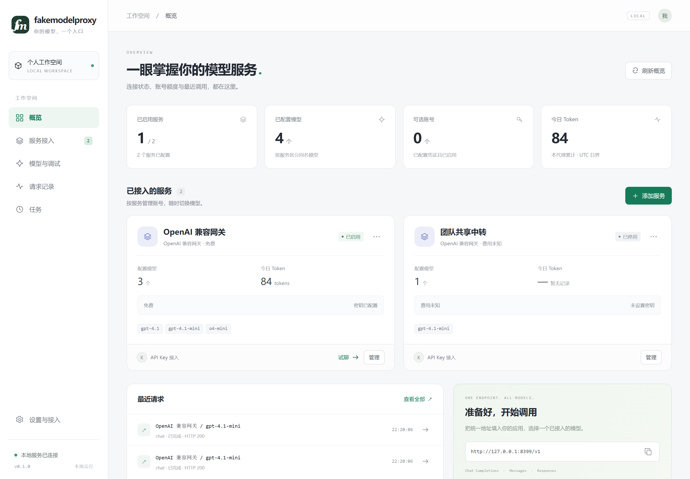
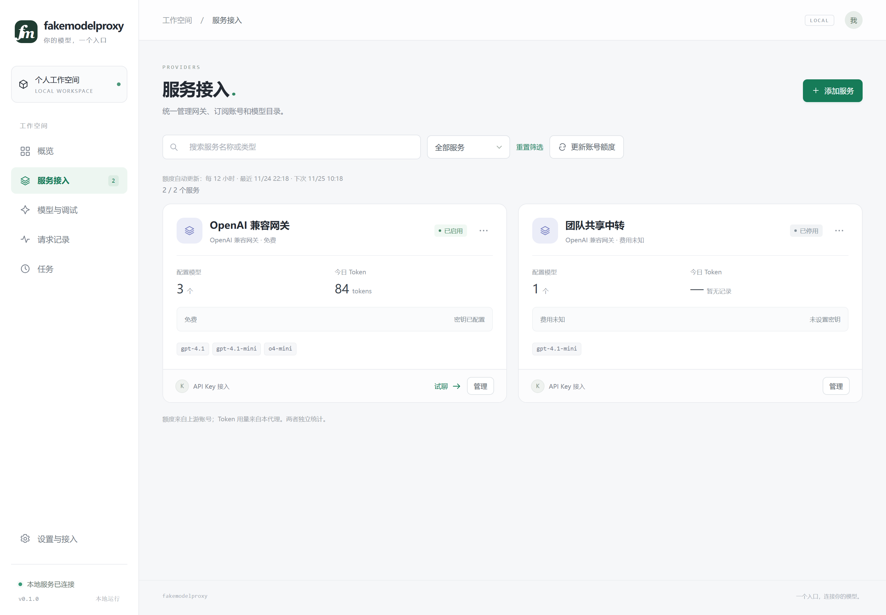
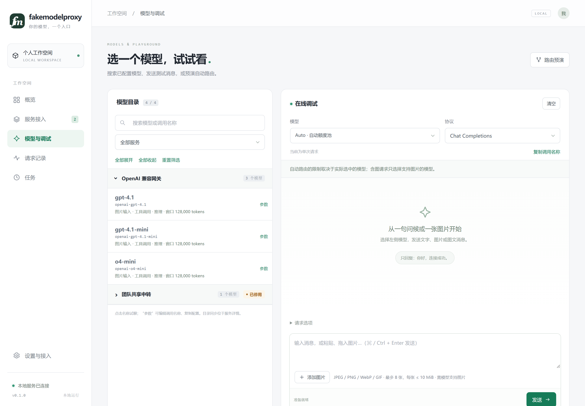
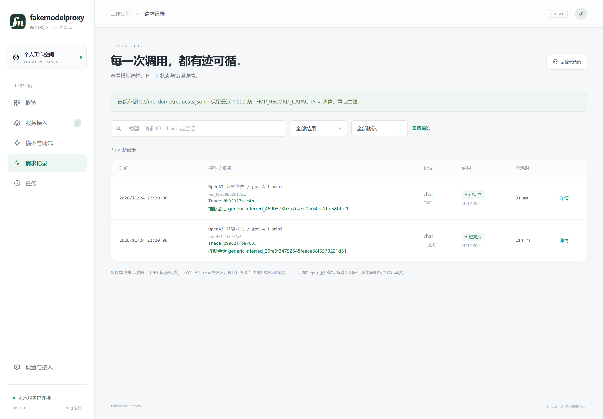

# fakemodelproxy（FMP）

面向个人部署的模型网关。一个 Rust/Axum 进程提供 OpenAI Chat Completions、
OpenAI Responses 和 Anthropic Messages 接口，通过本地 Web 控制台管理服务与账号。
配置、凭证、用量和任务状态持久化到 SQLite，前端使用原生 JavaScript，无需单独构建。

- **统一推理入口**：三种协议共用网关，支持流式响应、工具往返及按模型能力接入图片。
- **统一调度**：`auto` 按能力、额度和费用筛选服务，再分配模型与账号；显式模型固定服务。
- **统一管理**：Web、`fmp` CLI 和 `fmp-mcp` 共用在线管理 API、配置版本和可查询的操作状态。
- **服务扩展**：内置 9 个代码插件，兼容 API 可通过公开预设接入；额度、续期和签到按插件能力提供。

## 控制台

控制台由同一个进程内嵌提供，无需单独构建；以下截图使用本地演示数据。

| 概览 | 服务接入 |
| :---: | :---: |
|  |  |

| 模型与调试 | 请求记录 |
| :---: | :---: |
|  |  |

## 快速开始

需要 Rust 1.94.0 和 Cargo；`rust-toolchain.toml` 固定工具链与检查组件。
在本目录执行：

```sh
cargo build --locked --bins
./target/debug/fakemodelproxy
```

打开 <http://127.0.0.1:8317/>：

1. 在「服务接入 → 添加服务」选择提供商或 OpenAI 兼容预设。
2. 填写 API Key，或保存服务后通过「登录账号」完成该插件的授权流程。
3. 启用服务并同步模型目录，在「模型与调试」确认可调用模型、能力与费用。
4. 复制模型调用名称或选择 `auto`，从客户端发起请求。

首次启动不会自动获得上游账号或推理额度。使用 `auto` 前，应确认服务的费用层级、
模型能力和账号可用性；费用未知的服务默认不进入主额度池。

默认仅监听本机回环地址，不校验调用密钥。设置 `FMP_API_KEY` 后，客户端使用
`Authorization: Bearer <调用密钥>`；管理密钥在控制台「设置与接入」填写。
监听非回环地址必须设置调用密钥。

## 客户端接入

标准客户端的 Base URL 为 `http://127.0.0.1:8317/v1`。

| 方法与路径 | 用途 |
| --- | --- |
| `GET /health` | 进程健康检查 |
| `GET /v1/models` | 已启用服务的模型调用名称及 `auto` |
| `POST /v1/chat/completions` | OpenAI Chat Completions |
| `POST /v1/responses` | OpenAI Responses |
| `POST /v1/messages` | Anthropic Messages |

完成服务接入后，本机默认配置可用以下请求：

```sh
curl http://127.0.0.1:8317/v1/chat/completions \
  -H 'Content-Type: application/json' \
  -d '{"model":"auto","messages":[{"role":"user","content":"你好"}],"stream":true}'
```

启用调用鉴权时，增加 `-H "Authorization: Bearer $FMP_API_KEY"`。
显式调用使用控制台或 `/v1/models` 返回的名称；名称可持久修改，旧名称继续兼容。
详见 [模型调用名称](docs/guides/model-names.md)。

需要客户端会话关联时，可使用以下专用 Base URL；它们调用同一个网关：

| 客户端 | Base URL | 会话依据 |
| --- | --- | --- |
| TRAE | `http://127.0.0.1:8317/clients/trae/v1` | 客户端工具 ID 归一与已交付历史匹配 |
| MiniMax Code | `http://127.0.0.1:8317/clients/minimax-code/v1` | 客户端原生会话头 |

通用客户端可通过 `X-FMP-Session` 显式提供会话 ID。没有明确 ID 时使用历史推断；
相同首轮保持独立，匹配歧义时拆组。客户端插件与上游服务插件相互独立，
例如 TRAE 客户端可以调用其他提供商。详见 [客户端会话关联](docs/design/client-sessions.md)。

## 内置服务

| 服务 | 插件 ID | 接入说明 |
| --- | --- | --- |
| OpenAI 兼容网关 | `openai_compat` | [地址、API Key、模型与公开预设](docs/providers/openai-compat.md) |
| ModelScope 魔搭 | `modelscope` | [官方 Access Token、模型目录与魔粒](docs/providers/modelscope.md) |
| Qoder | `qoder` | [模型、工具历史与排队行为](docs/providers/qoder.md) |
| WorkBuddy | `workbuddy` | [模型目录、积分倍率与签到](docs/providers/workbuddy.md) |
| AutoGLM | `autoglm` | [国内短信登录与国际 OAuth](docs/providers/autoglm.md) |
| MiniMax Code | `minimax_code` | [国内／国际设备 OAuth](docs/providers/minimax-code.md) |
| MonkeyCode | `monkeycode` | [独立 Chrome 窗口完成官网登录](docs/providers/monkeycode.md) |
| 小浣熊 | `raccoon` | [官网授权与本机回调](docs/providers/raccoon.md) |
| TRAE CN 个人版 | `trae_personal` | [个人账号授权、设备上下文与积分](docs/providers/trae.md) |

授权方式和部署条件因插件而异：小浣熊及 AutoGLM 国际站要求浏览器与代理同机；
MonkeyCode 官网登录要求代理回环监听，并在代理电脑安装 Chrome；
MiniMax Code 设备授权可在另一台电脑完成。TRAE 后端当前只支持个人 CN 区域。
各模型的工具、图片、上下文和输出限制以实际目录及适配器约束为准。

## 调度与恢复

`auto` 先进行能力、健康、容量和额度准入，再按费用与额度可信度分层，
同层按优先级选择，同级结合倍率和负载分散。默认使用免费和已有套餐额度；
在「设置与接入 → 网关调度与恢复」可开启付费及费用未知的后备服务。
旧 `auto:*` 调用名称继续兼容，`auto:free` 始终禁止付费后备。

三种入口与显式模型共用总尝试预算、时限和完整流容量租约。
只有可证明未执行的失败才安全重试；未知执行、流中错误和部分工具输出不重新生成。
客户端断开会取消上游并释放容量。

配置热加载保留在途请求、健康状态和已有绑定。会话指纹与分组绑定只保存在内存，
重启后重新分配。不同模型的能力与质量不等价，可配置候选模型范围和优先级。
完整规则见 [Auto 路由](docs/design/auto-routing.md)。

## 启动配置

| 环境变量 | 默认值 | 用途 |
| --- | --- | --- |
| `FMP_LISTEN` | `127.0.0.1:8317` | 监听地址 |
| `FMP_DATA_DIR` | `.fakemodelproxy` | 相对当前工作目录的数据目录 |
| `FMP_API_KEY` | 空 | 推理调用密钥 |
| `FMP_ADMIN_KEY` | 复用调用密钥 | 管理认证密钥 |
| `FMP_ACCESS_KEYS` | `[]` | 具名管理身份及权限范围 |
| `FMP_LOG` | `info` | 日志过滤规则 |
| `FMP_MAX_REQUEST_BODY_MB` | `64` | 对话请求体上限，单位 MiB |
| `FMP_RECORD_CAPACITY` | `1000` | 保留的最近请求记录数 |

数据目录保存 `fakemodelproxy.db` 和 `requests.jsonl`。长期运行应为
`FMP_DATA_DIR` 设置固定路径；数据库、凭证和运行记录需要按个人数据管理。
请求体与记录数量必须为正整数，修改启动参数后需重启。
后台额度刷新、自动签到、QPS 和请求记录字段见 [服务配置](docs/guides/configuration.md)。

## CLI 与 MCP

先启动网关，再从另一终端读取在线服务：

```sh
./target/debug/fmp --help
./target/debug/fmp identity
./target/debug/fmp plugins list
./target/debug/fmp plugins describe openai_compat
./target/debug/fmp config get
```

CLI 和 MCP 使用 `FMP_SERVER` 指定管理服务，默认 `http://127.0.0.1:8317`；
认证使用各自进程的 `FMP_ADMIN_KEY`，CLI 也支持 `--server URL`。
`fmp-mcp` 是 stdio 管理客户端，配置示例见 [管理 API、CLI 与 MCP](docs/guides/management.md)。

配置修改遵循 `validate → plan → apply`，使用当前 revision 和幂等键。
秘密从独立接口写入，配置只保存 `store:`／`env:` 引用。操作返回 `waiting_user`
时完成授权交互；返回 `unknown` 时先查询结果，不自动重放。
字段与能力以在线 `/api/v2/schema`、`/api/v2/openapi.json` 和插件目录为准；
[生成契约快照](docs/generated/README.md)供离线阅读。

## 开发与技术设计

| 目录 | 职责 |
| --- | --- |
| `src/core`、`src/ingress` | 归一请求／事件与三种入站协议 |
| `src/gateway`、`src/routing` | 生成生命周期、模型准入与账号调度 |
| `src/plugins`、`src/backend` | 服务能力组合、授权及上游传输 |
| `src/application`、`src/store` | 配置版本、权限、操作与 SQLite 持久化 |
| `src/client_plugins` | 客户端会话证据 |
| `src/tooling`、`src/bin` | CLI、MCP 与插件开发工具 |
| `web`、`presets` | 内嵌控制台与公开服务预设 |
| `tests`、`scripts`、`examples`、`packaging` | 自动化回归、源码检查、契约导出与发布工具 |
| `docs` | 技术设计、接入说明和生成契约 |

从 [当前架构](docs/design/architecture.md)了解模块与状态边界，
从 [插件开发](docs/guides/plugins.md)了解能力契约、脚手架和注册方式。
兼容 API 优先使用预设；代码插件需要编译并重启，服务实例可热启停。
[ADR 0001](docs/adr/0001-original-architecture-superseded.md)保留初始设计背景。

回归验证在本目录执行，需要 Node.js 22 与 Python 3.11 或更高版本：

```sh
cargo fmt --all --check
cargo clippy --locked --all-targets -- -D warnings
cargo test --locked --all-targets
node --check web/console.js
node --test web/console.test.cjs web/autoglm-login.test.cjs
python3 -B -m unittest discover -s scripts -p 'test_*.py'
python3 -B scripts/check_public_source.py
```

回归使用隔离存储和本地假上游。测试临时数据库放在系统临时目录；
构建缓存位于 `target/`，不纳入源码。Windows 打包见 [构建说明](packaging/windows/BUILD.md)。

## 开源与发布

项目采用 [MIT 许可证](LICENSE)。贡献流程见 [CONTRIBUTING.md](CONTRIBUTING.md)，
漏洞报告见 [SECURITY.md](SECURITY.md)，社区约定见 [CODE_OF_CONDUCT.md](CODE_OF_CONDUCT.md)。
[文档索引](docs/README.md)集中列出技术设计、接入指南和生成契约；
[变更记录](CHANGELOG.md)及[第三方依赖声明](THIRD_PARTY_NOTICES.md)随源码维护。

生成可上传 GitHub 的源码包：

```sh
python3 -B scripts/package_source.py --output ../fakemodelproxy-0.1.0-source.zip
```

打包器只收集公开源码白名单，检查敏感标识与文档链接，并输出 SHA256。
源码包包含 `.github` 工作流、模板和贡献文档。相同源码生成相同 ZIP；
输出路径已存在时需选择新路径。数据库、凭证、设备报告、请求记录和编译缓存
不进入源码包或 Cargo 发布包。上传前可检查 Cargo 的实际发布清单：

```sh
cargo package --locked --list > /tmp/fmp-package-files.txt
python3 -B scripts/check_public_source.py --package-list /tmp/fmp-package-files.txt
```

提供商名称用于说明兼容接口，不代表官方合作或授权。使用者需遵守各提供商的
服务条款、账号限制和数据政策。
