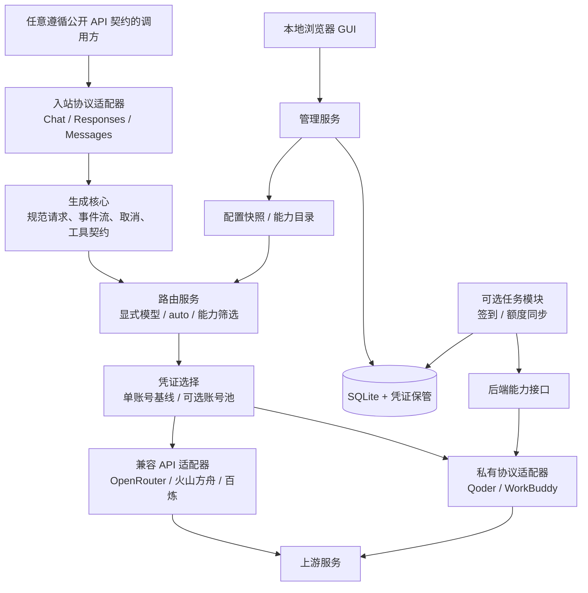

# ADR 0001：初始架构提案（superseded）

本提案保留历史上下文。2026-11-21 起由 [当前架构](../design/architecture.md) 替代；下文的待评审状态、模块设想和阶段描述不代表当前实现。

状态：待评审，未开始产品实现。修订：v0.2，2026-11-18。

统一 Auto 补充（2026-11-20）：对外只发布 `auto`，内部先进行能力/健康/额度准入，
再按费用池、额度可信度和配置优先级分层，同计费范围使用倍率择优，
同级通过两级负载分配新会话。原 auto 变体只作为兼容别名，付费后备默认关闭。
优先级表达同费用/额度层的主备顺序；相同优先级表达可分摊的服务。

网关实现补充（2026-11-20）：统一 `Gateway` 承担三个协议、Auto 和显式模型的
生成生命周期，包含总预算、安全重试、有效启动检查、完整流容量租约和取消。
`Balancer` 跨重载保存原子分组绑定、两级负载与局部冷却；`HistoryIndex`
只持有有界指纹，支持 TRAE 包装规范化与唯一工具锚点。客户端组 ID 与绑定拥有的
厂商 UUID 分开。配置持久化，绑定/指纹本期仅在内存；启动不恢复在飞计数。
服务后台刷新目录与额度，生成只读本地快照。当前使用方式以
[Auto 路由](../design/auto-routing.md)及[服务启动配置](../guides/configuration.md)为准；
下面保留最初设计提案，不能作为当前实现状态说明。

配套的初始功能规划与实施进度记录已清理；当前使用与验证入口见
[项目说明](../../README.md)，技术边界见[当前架构](../design/architecture.md)。

实现补充（2026-11-20）：MiniMax Code 使用独立设备 OAuth 接入，包含凭证续期、三协议流转换、积分余额与签到。Auto 现支持优先级、倍率和剩余额度三种排序，共用模型与账号准入。原始设计提案保留于下文。

MonkeyCode 使用独立账号适配器，支持官网登录、HMAC 系统提示签名、按模型目录选择三种出站协议、会员权限筛选、钱包查询和每日签到。已完成真实文本、流式响应及工具调用验证，详见 [MonkeyCode 接入](../providers/monkeycode.md)。

AutoGLM 保留独立客户端适配器，包含国内短信网页、海外 OAuth、凭证续期、模型目录、钱包和账号级签到。其上游不执行 `max_tokens`，Auto 采用独立输出预留。接入与预算边界见 [AutoGLM](../providers/autoglm.md)。

实现修正（2026-11-19）：三个入站协议仅从非空 `X-FMP-Session` 读取明确的会话标识。Chat 的 `user` 与 Messages/Responses 的 `metadata.user_id` 是用户身份，不用于上游会话或路由亲和；没有会话头时，私有适配器为请求生成独立会话。这样同一用户的多个聊天不会因用户字段相同而共用一个上游会话。

请求体边界（2026-11-19）：三个对话入口默认允许 64 MiB 完整请求体，通过 `FMP_MAX_REQUEST_BODY_MB` 调整；超限返回对应协议的 JSON 413。管理 API 保持独立限制，代理不裁剪聊天历史。具体行为见[启动配置](../guides/configuration.md)。

## 1. 设计结论

推荐采用 **Rust 单进程 + 本地 Web GUI + SQLite + 统一请求/事件模型 + 后端适配器 + 可选能力模块**。Rust 是根据本轮用户意见评估后的首选提案，尚未锁定依赖或开始实现。

对外边界按 OpenAI Chat Completions、OpenAI Responses、Anthropic Messages 的公开 API 契约及明确支持子集定义。**不绑定具体客户端，不建设客户端品牌识别、专用配置或客户端版本验收矩阵。** 工具声明、调用与结果回传是协议语义，仍需验证；验证由通用协议测试驱动，不依赖某个 IDE。

保留 fakemodel 的协议与后端解耦方式；不引入它的工作空间、租户、组织权限、用户配额体系和 PostgreSQL。Qoder、WorkBuddy 的私有协议只存在于各自适配器内，不进入通用路由与前端协议实现。

这是新项目的规划，不是对参考仓库的直接裁剪。下文“决定”均为推荐设计，等待本轮评审；外部协议事实另列证据。没有真实账号连通测试，因此不宣称两个私有后端已能工作。

| 决策 | 推荐方案 | 原因 |
|---|---|---|
| 部署 | 单进程、单数据目录、默认仅本机监听 | 匹配个人使用，无集群协调成本 |
| 实现语言 | Rust + Tokio，Axum 提供 HTTP 接口 | 类型与生命周期约束适合协议事件和并发状态管理 |
| GUI | Rust 服务内嵌 React + TypeScript 构建产物，浏览器访问 | 不要求用户安装 Node；暂不做 Electron/Tauri 壳 |
| 持久化 | SQLite 作为运行配置与状态唯一事实源 | GUI、刷新任务、签到和用量记录需要事务 |
| 配置文件 | 启动参数 + 脱敏导入导出文件 | 不与 SQLite 双向热同步，避免谁覆盖谁的问题 |
| 可插拔 | 编译期注册、运行时独立启停的进程内模块 | 首版保留边界，不承担跨平台动态库 ABI 成本 |
| auto | 明确候选集、能力硬筛选、规则排序、有限故障切换 | 可解释、可复现，不额外调用模型作分类器 |
| 私有后端 | Qoder 和 WorkBuddy 均为首个完整版本目标，带独立验证门槛 | 核心可先交付；不能用空适配器宣布两者已支持 |

### 1.1 Rust 选型与代价

| 维度 | Rust 方案的收益 | 代价与限制 |
|---|---|---|
| 协议表达 | 用 enum 表达事件/终态/能力，用 match 检查分支覆盖 | 类型设计仍可能遗漏协议语义，不能代替契约测试 |
| 并发资源 | 所有权与租约 guard 明确本地资源释放时机 | async 任务需要显式取消与回收；Rust 不自动避免业务竞态 |
| 常驻运行 | 无追踪式 GC，可控制流缓冲与资源占用 | 个人规模下没有证据证明比 Go 更快；耗时主要受上游与网络影响 |
| 维护 | 小而明确的 trait 与类型边界便于扩展后端 | async/dyn/lifetime 与编译成本高于直接沿用 Go 参考实现 |
| 代码迁移 | 可独立实现协议，不受现有 Go 包结构牵制 | qoder2api/fakemodel 的 Go 实现不能直接当 Rust 库使用；需重新实现与对照验证 |
| 分发 | 一个服务二进制包含静态 GUI，SQLite 可随包编译 | SQLx 的 bundled SQLite 仍需构建机的 C 工具链；不代表所有依赖均为纯 Rust |

判断：这是尚未进入开发的新项目，采用 Rust 不涉及已投入产品代码的迁移，适合作为长期维护的首选。若唯一目标变成最快验证某个私有协议，现有独立桥接服务仍可作临时黑盒对照；不因此改变主程序语言。

### 1.2 推荐技术组件

| 层 | 首选 | 使用边界 |
|---|---|---|
| 异步运行时 | Tokio | HTTP、定时任务、并发限额；阻塞工作不进入异步执行线程 |
| HTTP 与 SSE | Axum + Tower/Tower HTTP | 路由、鉴权、请求限额、响应流；不能用普通 handler 超时替代整条响应流的空闲超时 |
| 上游 HTTP | Reqwest，默认 Rustls | 按后端复用连接；显式代理/超时/重定向策略；不宣称 TLS 指纹与官方客户端相同 |
| JSON / 规范模型 | Serde + serde_json | 核心强类型；JSON Schema 与厂商扩展容许受控 Value/原始数据，不将整个核心退回裸 map |
| 数据库 | SQLx SQLite | 迁移、短事务、用量预留；只启用所需运行时和 SQLite 功能 |
| 取消与停机 | tokio-util CancellationToken + 任务追踪 | 请求取消、模块关闭和进程排水有独立作用域 |
| 可替换后端 | trait 对象 + async-trait | 只在后端/策略边界动态分派，避免整条管线泛型化；不做 Rust 动态库加载 |
| 诊断 | tracing + tracing-subscriber | request/attempt span，字段脱敏；协议错误保持显式类型 |
| GUI | React + TypeScript 静态产物 | 服务端负责嵌入与提供文件；Rust 不强制要求改成 Rust UI 框架 |

此处选组件，不预填未经构建验证的版本组合。实施时记录 Rust toolchain/MSRV、必要 feature、Cargo.lock 与目标平台；当前仓库仅有规划文件，没有安装依赖。

## 2. 系统分层



响应沿反向路径返回：上游解码器 → 规范事件流 → 入口协议编码器。管理服务修改配置，不直接执行模型推理；定时任务不拼接模型请求。

### 2.1 模块与依赖

| 模块 | 职责 | 不负责 |
|---|---|---|
| `protocol` | 请求解析、协议字段校验、SSE/JSON 编码、错误映射 | 账号登录、签到、后端排序 |
| `core` | Request/Event 类型、生成生命周期、取消、工具流一致性 | 识别 Qoder 或 WorkBuddy 的私有字段 |
| `routing` | 模型映射、能力筛选、auto 选择、会话绑定、故障切换 | HTTP 签名算法、执行客户端工具 |
| `backends` | 上游鉴权、请求构造、流解码、能力声明 | 直接向下游 HTTP writer 写数据 |
| `accounts` | 凭证保存、刷新互斥、状态、租用和释放 | 新建厂商账号、注册、扩充厂商额度 |
| `extensions` | 账号池选择器、签到调度、额度同步 | 任意注入提示词、绕过能力筛选 |
| `admin` / `web` | 配置、连接检查、路由解释、日志与任务操作 | 租户管理、组织权限 |
| `store` | SQLite 事务、迁移、备份、配置版本 | 持有网络请求期间的数据库事务 |

依赖方向：`protocol/admin/backends/extensions → core 契约`；装配层注入具体实现。`core` 不依赖某家后端，GUI 不读数据库文件。

建议先采用一个 Cargo package，以 lib 与 binary 分离可测逻辑和启动入口；不提前拆成大量 workspace crates。目录如下仅是设计，不创建空代码骨架：

```text
fakemodelproxy/
  Cargo.toml
  Cargo.lock
  src/
    main.rs
    lib.rs
    core/
    protocol/{chat,responses,anthropic}/
    routing/
    accounts/
    backends/{compatible,qoder,workbuddy}/
    extensions/{accountpool,checkin,quota}/
    admin/
    store/
    app/
  migrations/
  tests/protocol/
  tests/fixtures/
  web/
  docs/
```

### 2.2 Rust 的运行时与类型边界

- `Backend` 使用 `Send + Sync` trait 对象，由注册表持有；`describe` 返回元信息，`list_models` 与 `generate` 异步执行。采用 async-trait 处理动态调用，不假定原生 async trait 可直接作为 dyn 对象。
- `generate` 返回持有上游状态的 `Generation`，包含可逐步消费的 `Stream<Item = Result<GenerationEvent, UpstreamError>>`、取消句柄与清理上下文。替代 Go 风格 `Recv/Close` 的语法，保留同样的关闭契约。
- `GenerationEvent` 使用带数据的 enum；文字、工具参数、usage、结束不是一组可以任意组合的可空字段。能用类型排除的非法状态优先在类型层排除，时序正确性仍由生成状态机验证。
- 默认按下游拉取驱动上游流。确需后台读流时只用有界 channel，并设事件/帧/累计参数上限；不为每个 token 创建 task。
- 下游响应流被丢弃或写失败时，guard 发出请求级取消，释放本地并发许可。异步取消和账单记录由受追踪任务完成；不能在 Drop 中假定已完成网络取消或数据库写入。
- task 在等待流、退避和排队时都响应取消；spawn 后必须有生命周期归属。停机先停止准入与新任务，再通知取消并等待有限时间；远端动作是否完成仍可能未知。
- 配置采用 `Arc` 不可变快照；锁内只读取/替换快照，不持有锁跨越上游 await。预算和任务幂等依赖数据库事务，不靠内存所有权替代业务原子性。
- Reqwest 字节块不等于 SSE 帧或 JSON 消息。解码器处理跨块 UTF-8、CRLF、多行 data、注释与空行分帧，再解析厂商数据；设置帧大小上限。
- 签名后发送同一份序列化字节，不在签名之后重新编码 JSON。对传输层有特殊要求的私有后端保留局部替换点，不能假定更换成 Rust 即获得上游兼容。

## 3. 协议转换契约

### 3.1 对外协议范围

“标准协议”在本项目中指各提供商公开 API 的明确支持子集，不是一个覆盖全部厂商的统一标准。以协议版本/查阅日期、支持字段和事件形状为事实源；不以某款客户端的内部习惯作为实现依据。

| 入口 | 首个完整版本支持 | 明确边界 |
|---|---|---|
| `GET /v1/models` | 显式模型地址、别名、`auto` | 返回本机启用的目录，不虚构上游模型 |
| `POST /v1/chat/completions` | 流式/非流式、历史、图片、函数工具、tool_choice、usage | 各能力仍取决于所选模型 |
| `POST /v1/messages` | 文本/图片块、tool_use/tool_result、流式/非流式、停止原因 | thinking 签名与 cache_control 不保证跨协议无损 |
| `POST /v1/responses` | 文本/图片 input、instructions、function tools、工具结果、SSE | 首版仅完整历史的无状态请求 |
| `POST /v1/messages/count_tokens` | 本地估算并标注来源 | 非供应商权威 tokenizer，图像计算尤其有误差 |
| `/healthz` | 存活；管理界面另看后端健康 | 不触发收费推理 |
| 后续协议 | Responses WebSocket、响应存储/previous_response_id、Gemini 原生入口 | 按协议范围单独立项，不隐式承诺 |

首版对 Responses 的 `previous_response_id`、`conversation`、`background=true`、官方 opaque compaction 明确报不支持，并提示发送完整历史；不忽略后继续生成。这些条目直接列入协议能力表，不转化为特定客户端兼容承诺。

首版不提供音视频、图像生成、文件托管、批处理 API。工具类型中原生 function 为必需；custom/freeform 按 Responses 协议能力单独标记，只有可保留语法或用户选择等价包装时支持，不能假装成已验证能力。

### 3.2 规范模型

采用协议中立的类型；保留必要扩展信息，避免最小公分母吞掉语义。

| 类型 | 必要内容 |
|---|---|
| `GenerateRequest` | request ID、来源协议、请求模型、messages、tools、tool choice、输出上限、采样参数、推理设置、session key、保真要求 |
| `Message` / `ContentPart` | 角色；有序文本/图片/工具调用/工具结果；call ID；不把所有 block 压成一个字符串 |
| `ToolDefinition` | 稳定名称、说明、JSON Schema、工具种类、可选原始语法 |
| `ModelCapabilities` | tools、工具选择模式、并行工具、图片、结构化输出、推理、多模态、上下文与输出上限；支持/不支持/未知 |
| `NativePayload` | 来源协议、原始 body/允许的头、来源绑定信息、不可迁移项；仅用于合格的保真通道 |
| `GenerationEvent` | 文本/思考增量、工具开始/参数增量/结束、usage、排队、finish；有序序号 |
| `UpstreamError` | 类别、上游状态、retry-after、请求是否发出、是否确定未受理、是否可安全重试、脱敏细节 |
| `GenerationOutcome` | 完成/失败/取消/执行结果未知；实际 backend/model/account/attempt、用量来源与估算标记 |

能力不是后端级布尔值：至少按 **后端实例 + 账号可见模型 + wire 协议 + 版本** 描述，并附证据来源与检查时间。共享默认能力可以继承；账号差异、模型差异必须覆盖。

`NativePayload` 不是“任意字段原样穿透”：同协议也可能换了供应商或账号。thinking 签名、加密 reasoning、缓存引用、上游 session ID 需要来源绑定。不能转换又不能在原绑定运行时返回明确错误；禁止把旧绑定数据塞给新模型尝试。

### 3.3 两条出站路径

1. **规范化路径**：入站 decode → 规范请求 → 能力校验 → 后端 builder → HTTP/SSE → 规范事件 → 入站协议 encode。
2. **保真路径**：同协议且后端声明兼容，保留允许的原始字段；统一鉴权、路由、用量和取消仍执行。修改模型、max tokens 或 tools 时由专用 patcher 同步变更，不能发送修改前的原始 body。

官方兼容 API 共用基础编解码器；endpoint、鉴权头、模型目录、请求字段例外由 provider profile 指定。Qoder/WorkBuddy 可使用版本化信封模板，但每次必须显式设置/删除 messages、tools、tool_choice 等动态字段，禁止继承官方客户端默认工具集。

### 3.4 工具与输出规则

- `tools` 省略/空数组 → 本次不声明可用工具；`tool_choice=none` → 即使有定义也禁止调用。显式 choice 无法表达时拒绝，不能静默改为 auto。
- 客户端工具由客户端执行。fakemodelproxy 不实现 Bash/Read/Edit，更不因为工具同名就在本机执行。
- 保留 call ID、名称、参数和结果的配对；若改名，创建请求级可逆映射。孤立工具结果首版返回校验错误，避免猜测历史后掩盖客户端问题。
- 工具参数按调用 ID/index 归并，增量不伪装成完整 JSON；结束时验证完整性。非法/截断参数返回失败，不补 `{}` 来制造成功。
- 默认不将结构化输出转成隐式工具；后续若加该兼容模式，必须标记转换语义并受能力策略约束。
- reasoning 与正文分开；能转换时转换，不能转换的签名不造假。没有 usage 返回“未知/估算”，不填 0 当作真实计费。
- 保留 stop/length/tool_calls/content_filter 等结束原因；仅 EOF 且无终态视为流中断，不自动当正常结束。
- 有界缓冲、客户端写超时和取消向上游传播；不为统计无限缓存全文。上游不支持任务取消时，记录“本地已断开，上游状态未知”。

## 4. 后端与可插拔能力

### 4.1 后端分型与准入

| 后端 | 实现路径 | 首版状态要求 |
|---|---|---|
| OpenRouter | OpenAI 兼容 profile，允许所需额外头 | 验证目标模型，不能用兼容标签代替 function calling 测试 |
| 火山方舟 | 兼容 profile + 区域/模型或 endpoint ID 配置 | 按官方 endpoint 使用；动态列表不可用时手填 |
| 阿里百炼 | 兼容 profile + 区域/Base URL 配置 | 不写死免费额度、有效期或模型能力 |
| 自定义 API | Chat / Responses / Anthropic wire 手选或验证后选择 | 不自动向猜测出的 URL 发送凭证 |
| Qoder | 原生私有适配器；开发中可经已有 qoder2api 侧车先接通兼容入口 | 单号模型与工具往返通过后再加入 auto；CN/Global 分实例 |
| WorkBuddy | 独立私有适配器，先区分模型请求 API 与远端 Agent 任务 API | 需验证登录、取模型、流事件、外部工具、会话、取消、用量 |

WorkBuddy 是明确需求，不能偷换成“让 WorkBuddy 当客户端连接本代理”。官方自定义模型文档证明的是 WorkBuddy 向第三方模型发请求，不能证明可反向取出内置额度。私有接口可行性本轮未验证。

适配器按验证结果标记：

- `model-native`：接收外部 messages/tools，返回原生工具调用，可满足公开模型协议的相应工具能力。
- `agent-session`：上游自行维护会话或执行工具。只在显式允许的路由中使用；不能满足外部工具需求时，不加入编程 auto。
- `unknown`：尚未完成能力验证；允许配置与诊断，不进入默认 auto。

若 WorkBuddy 只能跑远端 Agent，交付应明确“Agent 会话模式”，工具型模型支持仍未完成；不能通过 prompt+正则假装原生工具调用。

### 4.2 扩展点

后端主契约保持小而明确：`describe` 返回适配器版本与可选能力；`list_models` 按实例/凭证读取目录；`generate` 接收规范请求与已选定的模型/账号，返回可取消的 `Generation` 事件流（见 2.2）。调用上下文包含取消与时限；适配器不自行更换账号或模型。鉴权的厂商算法由后端实现，刷新互斥与持久化由账号服务协调。

| 扩展点 | 基线与可选实现 | 生命周期/边界 |
|---|---|---|
| `CredentialSelector` | 基线：选定单账号；可选：账号池 | Acquire/Release 租约；取消、错误均释放；禁用池后保留账号数据 |
| `AuthProvider` | 手填 key/token、合法登录流程、凭证刷新 | 刷新是凭证正确性的一部分，不能因禁用签到而停止；按账号 single-flight |
| `QuotaReader` | 可选的供应商余额/额度查询 | 只读；带检查时间、重置时间、单位、可信度；未知不是 0 |
| `CheckinProvider` | 后端声明可领取的签到/活动动作 | 不支持时 GUI 不出现可执行按钮；WorkBuddy 是否有此能力待证实 |
| `Scheduler` | 通用任务引擎，调用 CheckinProvider/QuotaReader | 不在请求热路径执行，任务失败不拖垮模型调用 |
| `RoutePolicy` | 内置 balanced / cost / latency | 只给排序建议，无权绕过 capability、费用和会话约束 |

“模块启停”不等于首版能安装任意第三方二进制：v1 通过 Rust trait 与注册表装配，配置开关生效；新模块代码需要重新构建。运行时开关控制实例/任务启停；Cargo feature 只用于可选构建裁剪，两者不能混淆。不依赖不稳定的 Rust 动态库 ABI。确有独立升级/故障隔离需求时，再做版本化本机 RPC 扩展，沿用同一契约。

### 4.3 账号池

一个账号属于一个后端实例；模型可见性、地区、登录态不串用。初始最多一个选中账号；启用账号池后可顺序优先或轮询，带同会话亲和与并发租约。每个账号只代表用户已有授权凭证。

状态维度分离：启用/停用、鉴权 ready/needs_login/refreshing、配额 available/exhausted/unknown、运行健康 ready/cooldown/open。避免一个 status 同时承担四种含义。

故障归属：401 触发一次刷新后重试鉴权；持续 401 → needs_login；429 按账号+模型冷却；额度耗尽等待有据可查的 reset；供应商 5xx 计入后端健康。用户关闭账号时，新请求停止选择，进行中请求默认排水。

上游身份或状态绑定到某账号时，池不能强行跨号切换。账号越多并不代表模型越强，也不会改变服务端权益。

### 4.4 签到与任务

默认关闭，用户按后端/账号启用，可手动执行。时间及时区可配置，以供应商活动窗口为幂等周期，不假定所有供应商每日零点重置。

使用唯一键 `(backend, account, job, provider_period)`，进程内互斥 + SQLite 任务领取事务，减少重复操作。任务状态包含 queued/running/succeeded/already_claimed/failed/unknown/skipped。

POST 后断线、进程崩溃或重启时，不能承诺 exactly-once。先查活动领取状态；无法查询时留在 unknown，不自动重复领取。支持有限退避；重新登录、权限缺失、业务明确拒绝均暂停并提示。禁用模块阻止新任务，已发出的动作尽力取消并记录结果。

## 5. auto 路由设计

### 5.1 语义

`model=auto` 表示 **在用户启用并加入候选集的后端模型中自动选择**，不是把字面量 `auto` 转发给供应商。供应商自身 auto 若存在，作为一个单独候选，标记最终模型可能不可知。

默认 profile 为 `auto`；用户可建立 `auto/coding`、`auto/fast`、`auto/economy` 等别名，但这些不是默认生成的承诺。显式模型地址只路由该目标，默认不跨模型兜底。

候选单位是 `(backend instance, upstream model)`，账号池是候选内部的凭证选择；不让十个同模型账号占据十个跨模型排序名额。每个 profile 保存候选、优先级、策略、费用准入、失败切换规则。

### 5.2 决策流程

1. 固化当前配置 revision，解析 profile 和显式绑定。
2. 从请求提取硬需求：图片、工具种类/choice、上下文、输出预算、结构化格式、不可迁移内容。
3. 排除禁用、未验证必需能力、地区不匹配、无可用凭证、额度已耗尽、冷却/熔断、费用不被允许的候选。
4. 对输入内容+工具定义+输出预留估算上下文，留配置余量；未知容量的模型不进入长上下文 auto，绝不静默截断历史。
5. 在可行候选中按用户优先级分层；选最高优先级层。层内先复用仍合格的会话绑定，再按策略排序。
6. `balanced`：近期失败较少 → 首 token 延迟较低 → 稳定候选 ID；`cost`：可比币种的估算边际成本较低 → 健康/延迟；`latency`：首 token 延迟较低 → 健康 → 可比成本。样本不足采用配置顺序，不捏造评分。
7. 获取账号/并发/预算租约并复查资格；状态已变化则选择下一候选，不能使用筛选前的过期额度快照。
8. 返回实际选择与排除理由，执行一次上游请求；失败仅按第 5.5 节判断是否换候选。

不使用固定“质量分”。用户将适合编程的模型放入 coding profile，通过优先级表达质量偏好。启用 cost 模式不代表允许选择任意便宜弱模型。

“同优先级保持会话”会优先于瞬时低价/低延迟，这是稳定性取舍；GUI 明示，用户可以关闭亲和。若带不可迁移上游状态，关闭亲和也不能解除强绑定。

### 5.3 免费与费用

初始 `auto` 候选集为空；添加后端不自动允许花费。用户逐项选择“只用已确认免费/套餐内额度”或“允许按量费用”，并可设置本地预算。

- credits、次数、tokens 不跨厂商直接换算。订阅内额度显示为套餐权益，不能把订阅总价写成 0 成本。
- 只免费模式只纳入有依据且未过期的免费权益；额度未知、套餐可能自动超额计费且无法阻止的候选不合格。查询接口只是观察，不能单独保证零扣费。
- paid 模式使用输入估算 + max output 上限 + 当前价格计算预留；币种不一致且没有用户提供换算依据时分组，不做隐式汇率转换。
- 并发预算在 SQLite 事务中预留，最终使用量结算。超时/取消但账单未知则保留 pending reconciliation，不能立即释放后假定零花费。
- 缺价格或 usage 时明确估算/未知。本地预算无法构成供应商绝对账单上限；严格封顶依赖供应商硬限额。允许 paid 不等于允许未知价格，后者单独选择。

### 5.4 会话与迁移

无状态公开协议不保证存在可用于跨轮绑定的会话 ID；默认无会话标识即无跨轮亲和。可选支持明确标记为本项目扩展的 `X-FMP-Session`，不要求标准调用方发送；不识别客户端品牌专用头，也不用首条提示词哈希把不同会话误合并。

保存绑定包含 profile revision、backend/model/account、wire、上游 session、保真绑定。普通无状态全历史请求可以在后续轮次按资格迁移；未回传结果的工具往返优先保持绑定。私有 Agent 会话和 opaque reasoning 必须保持绑定，除非适配器证明能安全重建。

能力/费用/停用硬条件优先于普通亲和；强绑定候选失效且不可迁移时返回 session_backend_unavailable，提示新会话，不把旧会话偷偷转给别家。

### 5.5 重试与副作用边界

区分“尚未输出”和“上游尚未执行”：没有 token 不代表远端 Agent 没有写文件或发消息。

| 场景 | 默认处理 |
|---|---|
| 尚未发出请求的 DNS/连接失败 | 预算内可尝试下一候选 |
| 明确未受理的 429/服务不可用 | 尊重 retry-after；无副作用且预算允许才重试 |
| 普通无状态推理，已提交但未产生客户端可见语义输出 | 可按策略有限切换，记录可能重复计费；“只免费”仍需满足费用资格 |
| Agent 会话/后端执行工具，提交结果未知 | 标记 execution_unknown；除非有幂等键/可查询证据，否则不自动重放 |
| 已输出文字/思考/工具参数 | 不切模型、不拼接两次输出；以该协议的流错误结束 |
| 无能力匹配或鉴权需重新登录 | 明确报错，不靠重试解决 |
| 客户端取消 | 停止调度，释放本地并发租约；上游取消是尽力操作 |

建议首版每个请求最多 2 次 attempt，等待/首字/总时限可配置；这是设计默认值，不是厂商限额或性能保证。只读目录查询与认证刷新有独立限额，避免三层自动重试相乘。

HTTP 提交与语义输出分开记状态。v1 尽可能在选择完成且取得首个可输出事件后再建立下游 SSE；此前的失败可保留 HTTP 错误码。若后续要在排队期间提前发心跳，必须保留单一 output ID 和流内错误逻辑，不能在重试时第二次发送“响应开始”。

### 5.6 可解释性

每个请求记录：候选集合、各自排除原因、选择原因、绑定是否生效、attempt、配置 revision、实际模型（若上游可知）、tokens 与成本来源。正常协议响应的 `model` 采用稳定入口名；实际路由可通过响应头与本地记录查看，不伪造底层模型品牌。

GUI 提供无模型调用的“路由预演”，输入工具/图片/上下文规模，显示当前资格与排序。它不等于连通测试，预测结果与正式请求时间不同可能因额度或健康变化而变化。

## 6. 数据、配置与本机访问

### 6.1 SQLite

使用 WAL、短写事务、busy timeout；同一个数据目录只允许一个活跃进程。热路径从不可变配置快照读取，生成网络流不持有事务。推荐 SQLx SQLite 的 bundled 方式，将 SQLite 链接进分发产物；构建需要 C 工具链，用户无需安装数据库服务。异步调用接口不改变 SQLite 的单写者约束，连接池保持小规模；不同时引入第二套 SQLite 驱动。

| 逻辑表 | 内容 |
|---|---|
| `backends` | 类型、显示名、Base URL/profile、region、启用状态、revision |
| `accounts` / `secrets` | 后端归属、凭证引用、加密密文、刷新版本、状态 |
| `models` / `capabilities` | 上游模型 ID、稳定外部地址、可用性、能力与证据 |
| `route_profiles` / `route_members` | 策略、候选、顺序、费用准入、预算 |
| `extension_settings` | 模块开关与账号级配置 |
| `jobs` / `job_runs` | 周期、幂等键、执行状态、结果、下一运行时间 |
| `usage_ledger` / `budget_reservations` | 用量、预留、结算、未知账单 |
| `request_records` / `attempts` | 脱敏路由与错误元数据、时间、usage |
| `session_bindings` | 路由绑定与私有 session 元数据、TTL；可重建状态 |
| `settings` / `schema_migrations` | 配置版本、应用参数、数据库升级记录 |

数据库保存元数据；正文和工具结果默认不记录。后续诊断正文采集需要明确开启与保留时限。私有会话若必须持久化敏感内容，应单独加密、明确保存原因，不混入普通请求日志。

GUI 保存流程：校验 → SQLite 事务提交 revision → 生成新快照 → 原子替换。失败则旧配置继续生效并反馈。进行中请求绑定旧快照，不因用户改 URL/模型而半途变向。

导入是显式操作，先预览差异再事务提交；不读取任意配置文件的修改自动覆盖 GUI。外部模型地址使用不可变内部 ID 映射，改显示名不破坏客户端。

### 6.2 凭证与访问

单用户仍有两种权限边界：调用模型的 API key，和能查看/修改后端的管理会话；这是入口鉴权，不是租户能力。一个个人 API key 足够起步，不做用户/角色表。

默认仅监听 loopback。首次启动生成随机调用 key 和管理解锁凭证；本机 GUI 解锁后使用 HttpOnly/SameSite cookie，校验 Origin/Host 与写入 CSRF。凭证不出现在 URL query、普通导出和日志中。

后端凭证采用带随机 nonce 的认证加密保存，主密钥独立文件（目录 0700、文件 0600）；之后可接 OS Keychain。独立文件只降低“单独泄漏 DB”的损失，不防整个用户目录被读走。备份恢复需保留主密钥；默认配置导出不带 secrets。

默认不暴露公网、不做团队访问；若将来添加局域网选项，需另行设计 TLS 和管理入口边界，不能只把监听改为 0.0.0.0 当作功能完成。

## 7. GUI 信息架构

五个页面足够：

1. **总览/接入**：按协议展示服务地址、通用 HTTP 请求示例、支持字段与错误边界、复制本机 API key、启用模型、近期请求/故障；无按客户端分类的配置向导。
2. **后端**：官方网关预设/自定义/Qoder/WorkBuddy；凭证、模型目录、手填模型、连通验证、账号子页。
3. **自动路由**：候选集、优先级、策略、费用边界、预演与具体排除理由。
4. **能力与任务**：按后端展开账号池、签到、额度同步；只有后端声明能力才可启用。
5. **请求记录与设置**：实际选择、错误和 usage；数据目录、备份、日志保留、连接/流超时。

“连接测试”拆成凭证/目录只读检查和用户触发的模型/工具回环测试；后者可能消耗额度。测试工具为进程内固定返回值的无副作用 echo，不读文件、不执行 shell。HTTP 200 或列出模型不等于测试通过。

## 8. 公开技术参考

后端使用独立的请求与事件契约。能够代理文本对话不代表完整支持工具语义；
模型身份、可用能力与额度必须由当前协议和账号状态确认。
引入第三方代码前应确认其许可证，并保留要求的归属声明。

Rust 技术依据，组件版本以 `Cargo.lock` 为准：

- [Axum SSE](https://docs.rs/axum/latest/axum/response/sse/)：从 Stream 构建 SSE，支持 keep-alive；不承担上游 SSE 解码。
- [Reqwest 流响应](https://docs.rs/reqwest/latest/reqwest/struct.Response.html#method.bytes_stream)：`bytes_stream` 需启用 stream feature，输出字节流。
- [SQLx SQLite](https://docs.rs/sqlx/latest/sqlx/sqlite/)：bundled 默认构建并静态链接 SQLite，构建机需 C 工具链。
- [Tokio 优雅退出](https://tokio.rs/tokio/topics/shutdown)：通知取消与等待任务结束是两个步骤。
- [async-trait](https://docs.rs/async-trait/latest/async_trait/)：异步 trait 方法的动态分派边界与 boxed future 开销。
