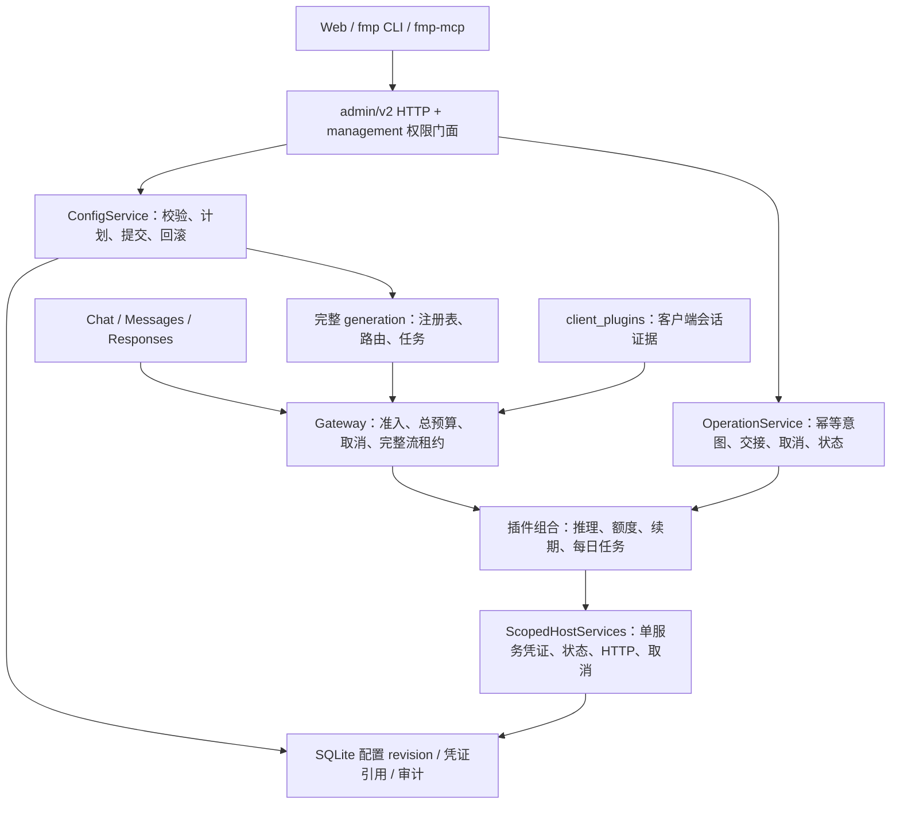

# 当前架构

状态：已实现的源码边界，2026-11-21。历史提案见 [ADR 0001](../adr/0001-original-architecture-superseded.md)，历史分期不代表当前实现。

FMP 是一个 Rust/Axum/SQLite 进程。推理入口、管理入口和后台任务共用宿主，但通过不同契约访问能力。对外主调用名称仍为 `auto`；三个协议共用统一网关。具体调度及恢复规则以 [Auto 路由](auto-routing.md) 为准。

## 依赖与扩展边界

| 模块 | 职责 |
| --- | --- |
| `core`、`backend/mod.rs` | 归一请求、事件、错误、能力和 Backend 契约 |
| `ingress`、`gateway`、`routing` | 三协议映射、统一生成生命周期、保守准入、绑定、冷却与负载 |
| `plugins/contract.rs`、`registry.rs`、`builtin.rs` | 插件描述、工厂组合和唯一内置注册清单 |
| `plugins/<provider>`、`backend/<provider>` | 服务控制/授权和现有协议传输实现 |
| `plugins/host.rs`、`service.rs` | 按服务隔离的宿主接口、宿主持有的费用/优先级/预算 |
| `application` | 版本化配置、权限门面、可跟踪操作、共享 API schema |
| `store` | SQLite 配置、秘密、任务/操作状态、额度缓存和兼容表投影 |
| `accounts`、`tasks` | 公共账号协调、额度快照、周期幂等和后台调度 |
| `client_plugins` | 从客户端请求提取会话证据，独立于上游服务插件 |
| `presets/builtin.json`、`presets.rs` | 公开数据化预设；引用已安装的代码插件 |
| `tooling`、`src/bin` | 管理 HTTP 客户端、CLI、MCP stdio、本地脚手架与编译验证 |
| `web` | 描述驱动的服务表单、分组、配置计划及操作历史 |

请求记录中的会话来源、TRAE 工具 ID 归一及推断边界见
[请求记录与客户端会话关联](client-sessions.md)。

新增内置协议增加插件模块和一个 `builtin.rs` 注册项。公共网关、额度批处理和任务装配通过能力目录发现实现。现有传输代码保留在 `backend`，不为目录整齐重复改写已验证协议。

`ProviderRuntime` 组合 `inference` 与可选 `quota`、`credential_refresh`、`tasks`，这些视图可以共享同一个 Arc。授权交互由插件自己的 `AuthControl` 和受控路由承载。账号派生与凭证规范化由 `AccountControl` 提供。

推理、额度和续期工厂只获取 `ScopedHostServices`。复杂授权的可信控制适配器仍使用 `AppState` 完成宿主编排。这是当前迁移边界，不能把进程内 Rust 插件当成第三方代码沙箱。

## 配置与运行状态

SQLite 中完整配置 revision 是已提交配置事实源。v1 表是兼容投影，CLI 不直接开库。v2 使用对象、数组和 `env:`/`store:` 凭证引用，字段来自 Rust 生成的 schema；插件 options 再按插件 schema 与语义校验。

配置保存遵循 `validate → plan(expected_revision) → apply(plan_id, idempotency_key)`。校验不调用上游；计划保存规范化摘要、影响路径、连接重建标识及 15 分钟期限。提交前构造完整运行快照，在短 SQLite 事务中比较 revision 并保存配置、审计与幂等结果，随后无网络 I/O 发布快照。

读取返回 `desired_revision` 和 `active_revision`。相等才表示配置已生效。进程在提交与发布之间退出，重启从已提交 revision 重建；重建失败会阻止正常启动，不静默切换到其他旧版本。回滚先生成新计划，随后创建新 revision，不回退用量、任务结果或轮换后的凭证。

每次推理捕获同一个完整 generation。在途流保持已选实例和容量租约；重载保留长期健康、绑定和冷却。显示名称、优先级等宿主策略变化可以复用连接能力。删除、停用或连接身份变化会撤销对应授权会话。

正常 token 续期使用独立凭证版本和 CAS，不产生配置 revision。动态目录、余额、健康、操作进度和审计也不作为声明配置反复提交。

## 操作、权限和界面

`OperationService` 在动作执行前保存意图与输入摘要。同键不同参数拒绝；同键相同参数查询原操作。进行中操作遇到进程重启转为 `unknown`，不会自动重放。授权可返回 `waiting_user` 和 `next_action`，由 UI 或 AI 交给用户。取消不能承诺撤回已完成的上游动作。

身份有 `read`、`config_write`、`operation`、`secret_write` 四类范围。v1 兼容管理仅接受全权限身份。授权需要操作、配置及秘密写入范围；模型同步需要操作与配置写入范围。非回环部署不能通过空管理密钥获得匿名管理权限。

UI 的“模型网关 / 逆向 API”是 `ui_group` 展示元数据。预设、插件、服务实例、账号和模型是不同对象；预设不声明余额、免费许可或模型真实能力。常用 options 标量/枚举来自 schema，复杂字段使用 JSON；专属验证码页面保留在插件控制流程。

## 当前可插拔范围

公开预设可在运行时校验后导入，现有实例不被预设升级覆盖。服务实例可热启停；代码插件仍需要编译与重启。MCP 仅封装相同管理 API，不开放任意 shell。进程外插件、动态库热加载与多语言 SDK 未实现；有独立发布或不可信执行需求时再增加对应协议和系统隔离。

操作方式见 [管理 API、CLI 与 MCP](../guides/management.md)，开发方式见 [插件开发](../guides/plugins.md)。服务启动参数见 [配置](../guides/configuration.md)。
